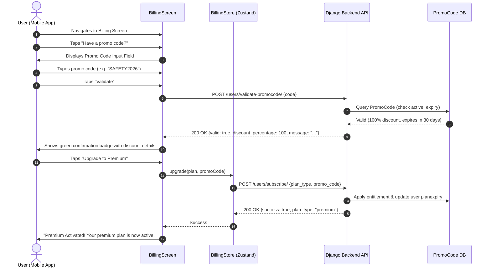

# SafeTNet Promo Code & Coupon Service Documentation

> **Comprehensive Guide**: Architecture, User Benefits, Operational Workflows, and Technical Implementation of the SafeTNet Promo & Coupon Code Engine.

---

## 1. Executive Summary

The **SafeTNet Promo Code & Coupon Service** is an integrated entitlement and promotional engine designed to make personal safety accessible, flexible, and rewarding. Operating within the SafeTNet ecosystem (React Native Mobile App + Django REST Backend), this service allows users to redeem discount vouchers and promotional codes to unlock **SafeTNet Premium** either at a discount or as 100% complimentary access without requiring upfront payment credentials (credit/debit cards).

By integrating directly with SafeTNet's billing architecture, the promo code system bridges marketing campaigns, corporate safety initiatives, and student/community programs with real-time app entitlements.

---

## 2. Core Benefits to Users

```
   ┌─────────────────────────────────────────────────────────────┐
   │                    USER VALUE PROPOSITION                   │
   ├──────────────────────────────┬──────────────────────────────┤
   │       Financial Value        │       Safety Upgrades        │
   │  • Zero-cost trial access    │  • Unlimited emergency ties  │
   │  • Discounted subscriptions  │  • Real-time route guarding  │
   │  • No credit card required   │  • Automated geo-fencing     │
   ├──────────────────────────────┼──────────────────────────────┤
   │      Frictionless UX         │     Community Inclusivity    │
   │  • Real-time code validation │  • University & NGO grants   │
   │  • Instant 1-tap activation  │  • Corporate safety perks    │
   │  • Clear discount feedback   │  • Senior citizen programs   │
   └──────────────────────────────┴──────────────────────────────┘
```

### 2.1. Immediate Unlock of Life-Saving Premium Safety Features
When users activate a promo code, they transition immediately from the Free Tier to the Premium Tier, unlocking essential safety protections:

| Feature | Free Tier | Premium Tier (Unlocked via Promo Code) | User Safety Impact |
| :--- | :---: | :---: | :--- |
| **Emergency SOS Contacts** | Maximum 3 | **Unlimited** | Users can alert extended family, friends, neighbors, and colleagues simultaneously. |
| **Route Guard & Deviation** | ❌ Not available | **✅ Real-time Active Monitoring** | Detects unexpected route detours or unusual prolonged stops during late-night commutes. |
| **Automated Geo-fencing** | ❌ Not available | **✅ Unlimited Zones** | Alerts loved ones instantly upon entering or leaving safe zones (home, school, campus, office). |
| **Live Location Sharing** | Basic (manual) | **✅ High-frequency background sync** | Ensures real-time tracking for trusted circles and emergency responders during emergencies. |
| **24×7 Response Center** | Standard | **✅ Priority Queue** | Direct routing to emergency services and security officers in high-risk situations. |

### 2.2. Zero Financial Risk & No Payment Friction
* **No Credit Card Required**: Traditional app store subscriptions require an active credit card or UPI setup with recurring auto-debit approval. A promo code eliminates payment anxiety—users can test all features without risk of unintended renewals.
* **Instant Activation**: There is no payment gateway redirection or SMS OTP delay. The service validates and provisions access in milliseconds.

### 2.3. Community & Institutional Sponsorship
* **Students & Campuses**: Universities can distribute educational promo codes ensuring students traveling home or attending evening classes are protected.
* **Corporate & Workplace Safety**: Organizations can provision complimentary safety subscriptions for female employees, night-shift staff, and field agents.
* **Community Outreach**: First responders and NGOs can sponsor high-risk neighborhoods with subsidized safety plans.

---

## 3. End-to-End User Experience (UX Flow)



### User Interface Highlights
1. **Collapsible Promo Drawer**: Kept clean and unobtrusive via a `"Have a promo code?"` toggle button.
2. **Auto-Capitalization**: The input field automatically normalizes codes to uppercase (e.g., `safety50` becomes `SAFETY50`), eliminating mobile keyboard casing errors.
3. **Pre-Purchase Validation**: Users can verify whether their coupon is active and inspect the exact discount percentage **before** committing.
4. **Contextual Feedback**:
   * **Success**: Distinctive green badge displaying the reward (e.g. `You will get 100% discount`).
   * **Error Handling**: Non-blocking red banner explaining why the code failed (e.g., *`This promo code has expired`*, *`This promo code is no longer active`*, or *`Invalid promo code`*).

---

## 4. Technical Architecture

### 4.1. Dual Billing Strategy (IAP vs Promo Code)
SafeTNet uses a hybrid monetization model:

```
                            [User Upgrade Trigger]
                                      │
                         Is Promo Code Provided?
                                ╱           ╲
                              YES            NO
                              ╱               ╲
    ┌───────────────────────────┐    ┌─────────────────────────────────┐
    │  Direct Backend Bypass    │    │      In-App Purchase (IAP)      │
    │  (Complimentary/Voucher)  │    │      (Google Play / Apple)      │
    ├───────────────────────────┤    ├─────────────────────────────────┤
    │ • Skips Store Billing     │    │ • react-native-iap checkout     │
    │ • Validates PromoCode DB  │    │ • Obfuscated user account ID    │
    │ • Sets user.plantype      │    │ • Backend receipt verification  │
    │ • Sets user.planexpiry    │    │ • Auto-renewable store billing  │
    └───────────────────────────┘    └─────────────────────────────────┘
```

### 4.2. Codebase Implementation Breakdown

| Component | File Path | Function / Responsibility |
| :--- | :--- | :--- |
| **Mobile UI** | [`BillingScreen.tsx`](file:///c:/Users/ADMIN/Desktop/SafeTNet/userapp/src/screens/billing/BillingScreen.tsx) | Renders promo code toggle, text input, validation button, feedback alerts, and upgrade CTA. |
| **State Store** | [`billingStore.ts`](file:///c:/Users/ADMIN/Desktop/SafeTNet/userapp/src/stores/billingStore.ts) | Zustand store orchestrating store IAP vs promo code bypass routing. |
| **API Client** | [`apiService.ts`](file:///c:/Users/ADMIN/Desktop/SafeTNet/userapp/src/services/apiService.ts) | Performs HTTP requests for `validatePromocode` and `subscribe`. |
| **Validation API** | [`ValidatePromoCodeView`](file:///c:/Users/ADMIN/Desktop/SafeTNet/users_profile/views.py#L1002-L1055) | Validates code existence, active status, and expiry timestamp without requiring prior authentication. |
| **Redemption API** | [`SubscriptionView`](file:///c:/Users/ADMIN/Desktop/SafeTNet/users_profile/views.py#L792-L872) | Authenticated endpoint checking promo code validity, calculating plan expiry (30 or 365 days), and activating Premium. |
| **Data Model** | [`PromoCode`](file:///c:/Users/ADMIN/Desktop/SafeTNet/safetnet/users/models.py#L566-L591) | Stores promo codes, discount percentages, activation flags, and expiry dates. |

---

## 5. API Reference & Contract

### 5.1. Promo Code Validation Endpoint
Allows the mobile client to inspect code validity before checkout.

* **URL**: `/users/validate-promocode/`
* **Method**: `POST`
* **Authentication**: `AllowAny` (public)
* **Request Body**:
  ```json
  {
    "code": "SAFEFREE100"
  }
  ```

* **Success Response (`200 OK`)**:
  ```json
  {
    "valid": true,
    "code": "SAFEFREE100",
    "discount_percentage": 100.0,
    "expiry_date": "2026-12-31T23:59:59Z",
    "message": "You will get 100.0% discount"
  }
  ```

* **Error Response (`200 OK` or `404 Not Found`)**:
  ```json
  {
    "valid": false,
    "error": "This promo code has expired"
  }
  ```

---

### 5.2. Subscription Activation via Promo Code
Redeems the promo code and provision premium benefits to the authenticated account.

* **URL**: `/users/subscribe/`
* **Method**: `POST`
* **Authentication**: `IsAuthenticated` (Bearer Token)
* **Request Body**:
  ```json
  {
    "plan_type": "premium-monthly",
    "promo_code": "SAFEFREE100"
  }
  ```

* **Success Response (`200 OK`)**:
  ```json
  {
    "success": true,
    "plan_type": "premium",
    "planexpiry": "2026-11-28",
    "message": "Successfully activated premium-monthly with promo code SAFEFREE100"
  }
  ```

* **Error Response (`400 Bad Request`)**:
  ```json
  {
    "success": false,
    "error": "Paid premium plans must be purchased through Google Play. A valid promo code is required for complimentary activation."
  }
  ```

---

## 6. Database Schema

The backend model definition in [`users/models.py`](file:///c:/Users/ADMIN/Desktop/SafeTNet/safetnet/users/models.py):

```python
class PromoCode(models.Model):
    code = models.CharField(max_length=50, unique=True, help_text="Unique promo code")
    discount_percentage = models.DecimalField(
        max_digits=5, 
        decimal_places=2, 
        validators=[MinValueValidator(0), MaxValueValidator(100)],
        help_text="Discount percentage (0-100)"
    )
    expiry_date = models.DateTimeField(help_text="Expiry date and time for the promo code")
    is_active = models.BooleanField(default=True, help_text="Whether the promo code is active")
    created_at = models.DateTimeField(auto_now_add=True)
    updated_at = models.DateTimeField(auto_now=True)

    def is_valid(self):
        """Check if promo code is active and within expiry period."""
        return self.is_active and timezone.now() < self.expiry_date
```

---

## 7. Business & Operational Value

1. **Low Customer Acquisition Cost (CAC)**:
   * Marketing campaigns can offer 30-day trial promo codes across social media or event sponsorships to boost user acquisition without complex checkout flows.
2. **High Conversion to Paid Subscriptions**:
   * Once users experience peace-of-mind features (such as Route Guard and Unlimited Emergency Contacts) during their promo period, retention and conversion to paid Google Play plans significantly increase.
3. **App Store Fee Optimization**:
   * Direct activation of complimentary access bypasses app store transaction processing fees on zero-revenue promotional vouchers.
4. **Targeted Campaigns**:
   * Admin dashboard integration permits managing individual codes with discrete expiration dates, discount levels, and active status for precise campaign control.

---

## 8. Summary Checklist for User Support & QA

- [x] Promo codes are case-insensitive on client entry (automatically capitalized).
- [x] Whitespace is trimmed on both client and server sides.
- [x] Pre-validation checks for expiration and active flag without requiring purchase.
- [x] Successful redemption automatically refreshes user profile state across all app navigation stacks.
- [x] Expired or deactivated codes display descriptive, friendly error messages to prevent confusion.
